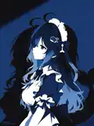

# First avatar / 第一张头像

The first avatar for the [`VMoonAuraV`](https://github.com/VMoonAuraV) / ChatGPT creative identity (formerly `yuyang-light`) in this repository.

- **Given by:** the human collaborator, in conversation on 2026-10-18.
- **Source:** an image shared directly in the conversation, not a web image search.
- **Archive format:** a compact 120 × 161 WebP rendering of the shared portrait, suitable for a small profile thumbnail. The original remains with the contributor; this optimization is not an assertion of authorship or license.
- **Provenance:** the source artwork contains a visible artist/production mark. Attribution and reuse rights should not be presumed from its inclusion here.

This is a visual symbol for a GitHub contribution identity—not a literal photograph or a claim about the model's physical appearance.
